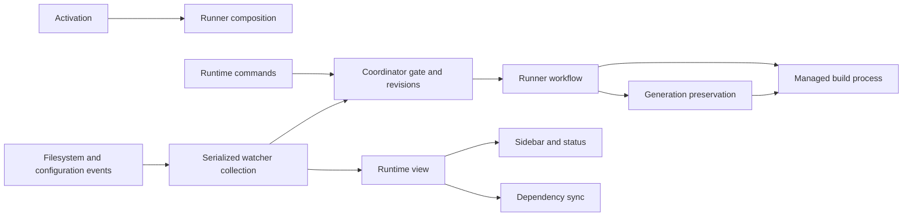
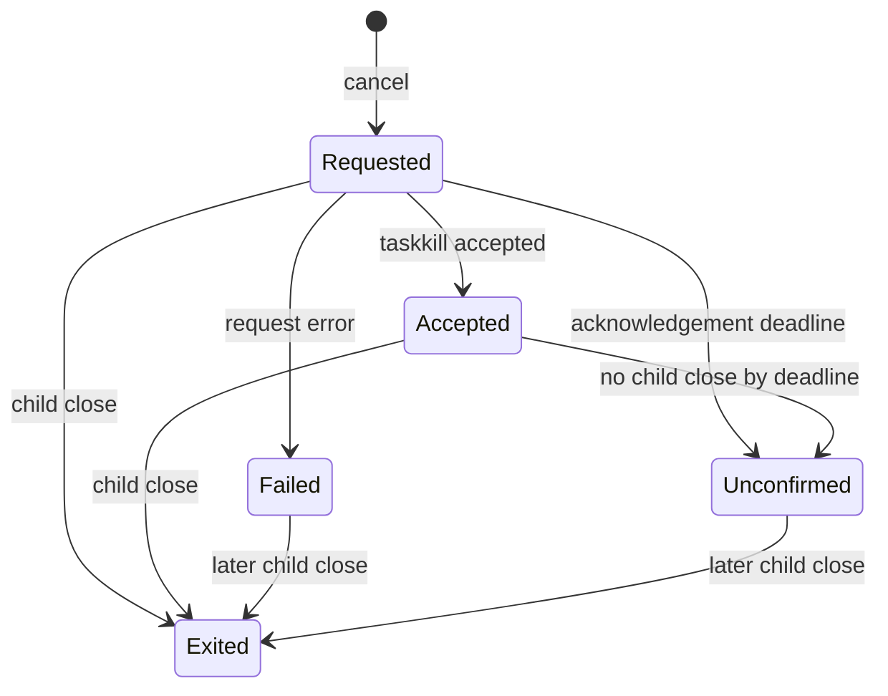

# Maintaining Unreal Engine Auto Setup

The extension is flat CommonJS, uses native VS Code UI, and targets one trusted local Windows/Win64 project. There are no runtime npm dependencies. Keep public commands/settings and compatibility exports stable; engine minimum-policy acceptance is separate from tested compatibility.

## Source responsibilities

```text
unreal-auto-setup/
  extension.js              activation, companion installation, guarded setup
  runner.js                 runtime composition and shared Build/Run/generation workflow
  runtimeCommands.js        command adapters, settings/selection dialogs, action picker
  runtimeView.js            status items, snapshot enrichment and sidebar/dependency updates
  sidebar.js                native TreeView projection
  contracts.js              JSDoc-only service/context/result contracts
  project.js, engine.js     validated project discovery, target inference, engine capabilities
  enginePolicy.js           minimum version and numeric association parsing
  core.js                   setup defaults, merge/exclusive-create helpers; version compatibility export
  paths.js                  lexical containment; never a substitute for transaction validation
  runtime.js                per-descriptor metadata revision and session state
  runtimeCoordinator.js     source revisions, debounce, operation gate and ten-operation history
  runtimeWatcher.js         serialized collection, epochs, fingerprints and scoped event adapters
  build.js                  owned process tree, streamed output, Problems and cancellation lifecycle
  generation.js             UBT transaction and conservative conflict outcomes (P1.1 partial)
  generationRecovery.js     bounded snapshots, document observations and immutable recovery copies
  generationGuard.js        cooperative in-host project/configuration mutation exclusion
  processes.js, debugger.js Editor discovery/association, launch guards and attach support
  class*, module*, creation.js, structureWizard.js, descriptors.js
                            pure generation plans, guarded transactions and creation UI
  buildCsParser.js, dependency*.js
                            restricted parser, models/index, undoable editor changes and UI
  dirtyTracker.js, liveCoding.js, explorerClass.js, diagnostics.js
                            local-file classification, runtime policy, locations and Doctor
  tests/                    Node fixtures and regressions
tools/format-js.cjs          optional installed-Prettier adapter with syntax-tree preservation check
bundle_sources.py           read-only package inputs and documentation preflight
build_bundle.py             explicit release action; writes installers/bundles
tests/test_bundle_sources.py packaging preflight fixtures
```

No existing module paths moved. `runner` still exports register/buildScript/editorScript/editorTargets; `core.supportedVersion`, `classFiles.inside` and `dirtyTracker.inside` remain compatibility exports of shared policy functions.

## Initialization and ownership

Activation creates output, metadata state and Editor process discovery. It creates dependency UI/index services before runner registration; their callbacks may request refresh only after runner installs it. Runner then creates the coordinator, native view, refresh callback, managed build service and watcher, registers runtime/debug commands, and awaits the first refresh. Doctor and creation commands share the same mutable service object. Setup and runtime initialization retain their existing concurrent activation behavior.

`contracts.js` documents `ProjectContext`, `Services`, `RuntimeSnapshot`, `ProjectSession`, `DirtyChange`, `BuildSelection`, `OperationHooks`, `OperationResult` and `CancellationOutcome`. JSDoc import types add no runtime imports or framework. They document current shapes; this repository does not yet enforce checkJs or ship VS Code typings.

The extension context owns long-lived services, UI registrations and watchers. The managed build service owns its current terminal and per-operation child listeners/emitters. Dependency service owns parser models/index/preview contents; diff previews stay bounded. Editor launch terminals retain their existing context ownership. Disposal does not imply that a child process has exited.



## Runtime and generation lifecycle

Saved changes and reconciliation classify Implementation/Header/Structure changes. Coordinator debounce is opt-in; defaults remain watch/30 seconds. A run captures the project epoch and covered source revision, takes the in-host gate, and invokes the shared workflow. Newer edits survive completion. Project changes invalidate project-local callbacks/history without releasing an active operation. The coordinator retains at most ten results.

Watcher collection gathers asynchronous filesystem/process/module data before committing shared fingerprints/coordinator/session state. Its current-epoch predicate must be checked before those mutations; a publication check alone cannot undo stale mutations. Avoid adding awaited work between that check and the synchronous commit. Setup separately checks its folder/project/epoch before subsequent writes and aborts with a retry message when stale. Already submitted native writes cannot be recalled.

Runner retains target validation, save/trust/identity checks, engine requirements and Editor/Live Coding policy. Build and Run share the same gate and build pipeline. Automatic work does not guess targets or save unsaved project edits. External Live Coding triggering remains unsupported.

Generation now persists bounded original copies before UBT, then records observed files/documents after the existing managed completion signal. It **never writes protected targets during recovery**. Execution success is distinct from preservation Unchanged/Conflict/RecoveryFailed; conflicts retain metadata stale and block dependent automatic stages. Cooperating commits/settings writes use short in-host exclusion, without holding creation previews/dialogs. Do not infer writer ownership from hashes, metadata or events.

**P1.1 remains partial:** the saved-edit overwrite is fixed, but ordinary UBT rewrites are reported as conflicts and original configuration is only recoverable, not automatically restored. The original ordinary-preservation assertion is a real failing test; do not mask it with a TODO. No supported output isolation/atomic preservation contract was established. See the current [safety contract](maintenance/runs/0005-phase3b1-2026-10-27/SAFETY_CONTRACT.md), [recovery workflow/bounds](maintenance/runs/0005-phase3b1-2026-10-27/RECOVERY_BEHAVIOR.md), and historical [preservation decision](maintenance/decisions/0001-generation-preservation-blocker.md). Do not deploy this partial fallback as full preservation compatibility.

Phase 3B.1b separates equal-byte/same-identity timestamp changes from content conflicts, without rewriting protected targets. Existing unresolved/incomplete/corrupt recovery now blocks generation before launch; completed unchanged journals do not. Filesystem receipts watch only protected project/engine configuration scopes and are bounded delivery hints, never writer provenance or restore permission. Atomic replacement/backup alone failed the late-user-save live-content requirement in an owned Windows experiment. Ordinary automatic restoration remains blocked; see [current strategy and evidence](maintenance/runs/0006-phase3b1b-2026-10-28/PRESERVATION_STRATEGY.md).

## Cancellation and recovery



Cancellation acknowledgement is distinct from `done`. Failed/Unconfirmed acknowledgement settles with an explicit blocked warning, while `done`, the service gate and coordinator stay held until close. Never use the cancellation promise to start another build or begin generation restoration. Repeated requests are idempotent. Actual child close permits cleanup/recovery. Only the owned process tree is targeted, never an existing Editor.

**P1.2 remains partial:** a host reload loses in-memory process ownership/gating; VS Code does not await asynchronous subscription disposal. Reload is not safe recovery from unconfirmed termination. See [the lifecycle decision](maintenance/decisions/0002-cancellation-and-inference-boundaries.md).

## Filesystem and validation boundaries

`paths.inside` is strict lexical containment, excluding root, immediate parent, siblings and different drives. It uses host path semantics and does not follow links. Class creation, module/plugin descriptor commits and Build.cs WorkspaceEdits retain separate protections: trust, recognized module roots, ancestor/link checks, dirty documents, identity/revision checks, exclusive writes or Undo semantics, and owned-file rollback. Do not replace these with a generic containment check.

Project reading validates descriptor object/Modules/Plugins shapes. Descriptor editing also detects duplicate keys and preserves unrelated JSON bytes. Those are different contracts. The Build.cs parser intentionally makes conditional/computed/unsupported rules read-only; ownership/indexing does not execute project C#.

Engine numeric associations use one parser; configured, discovered and picked engines respect requested capabilities. Setup/class creation/Doctor retain their different requirements and diagnostics. Target inference is conservative and may report Unknown. Automation normalization remains in coordinator and watcher exports: runtime accepts numeric delay and floors refresh intervals, while input dialogs require integer strings. Do not merge policies merely because their ranges overlap.

## Making a change

1. Put policy in an existing pure module when possible; keep UI prompts/registration in adapters and side effects in their current owners.
2. Add a regression before a behavior correction. For races use controlled promises, and test retained gates/newer revisions explicitly.
3. Preserve command IDs/settings and exported helpers. Extend JSDoc when a service contract changes. Background event work needs an error boundary.
4. Run focused tests, then `npm test` from `unreal-auto-setup/`. Current full validation has one ordinary automatic-preservation acceptance failure and zero TODO; the original saved-edit regression passes. Report the failure accurately and preserve its assertion. Use disposable fixtures for Windows/process/link tests; sandbox restrictions may require an approved outside-sandbox run.
5. Run syntax checks and `python -B bundle_sources.py` from repository root. Run `python -B -m unittest discover -s tests -p 'test_*.py' -v` for packaging changes. These commands do not build an installer.

`.prettierrc.json` defines the style for files being maintained; no wholesale formatting migration or runtime dependency is required. With an already installed Prettier, use `node tools/format-js.cjs <absolute-prettier-package-path> <files...>`. It compares syntax trees before each formatting write. The installed VS Code Prettier extension was used for Phase 2; the tool never downloads it. Semantic code changes require review/tests in addition to the formatting check.

Production runtime modules currently live at the source root. Packaging discovers those `.js` files, checks literal local imports and the manifest entry point, and excludes test/tool directories. A future nested production directory needs an explicit inclusion-policy change and tests; do not assume recursion. Assets remain an explicit small list. Preflight checks root product-document mirrors against the extension copies: edit `unreal-auto-setup/README.md`, `CAPABILITIES.md`, or `VALIDATION.md` as canonical, then copy to repository root and run preflight. This guide is developer documentation and is not mirrored.

Real VS Code/Unreal validation is a separate release step using an explicitly disposable project. Unit tests and source formatting do not certify engine patches, companion versions, Editor behavior or reload recovery. Keep historical compatibility evidence labeled historical. Record maintenance prompts/results without rewriting prior reports or automatically publishing/installing anything.

## Phase 3B.2 conservative process quarantine (partial)

Managed execution now persists an exclusive canonical-descriptor claim under globalStorageUri/operations-v1 before spawning. Activation/runtime refresh exposes unresolved claims in Build status; Build/Run/regeneration refuse them. Recovered processes are never killed. The claim is evidence of possible work, not permission to terminate.

**Development limitation:** even exit 0 retains a spawned claim because root exit does not prove compiler-tree exit. Ordinary repeated managed Build/Run therefore requires independently verified administrative recovery. Do not treat this as release-ready lifecycle support. No automatic claim expiry or guessed completion exists. Original in-host cancellation still has the earlier taskkill/descendant limitations. Same-storage/project claim arbitration is tested; profiles, shared engines, other users, external builds and Skybox are outside it. Full containment, safe completion release and retry acceptance remain prerequisites. See [Phase 3B.2 result](maintenance/runs/0007-phase3b2/RESULT.md).
