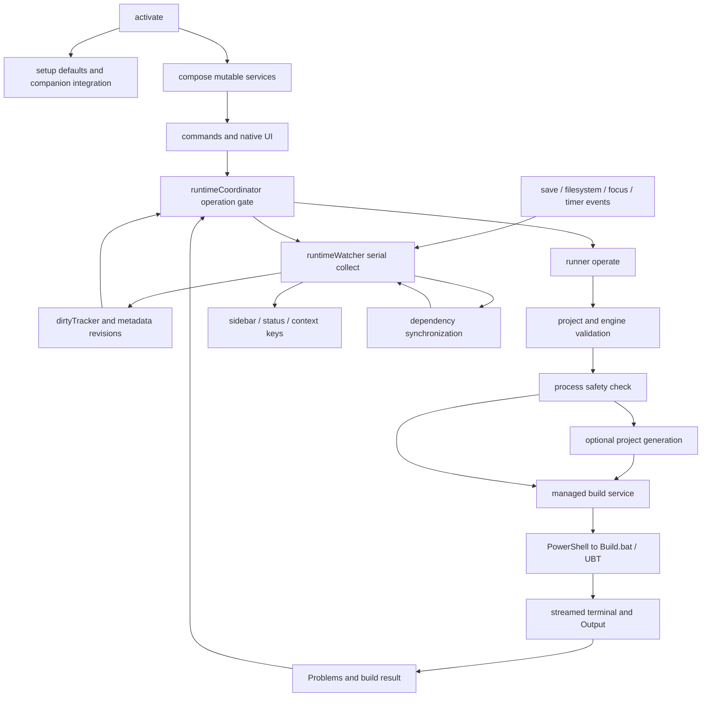

# Current architecture

The extension is a small collection of CommonJS modules with functional helpers and closure-based services. Its separation is already meaningful: parser/template code, filesystem transactions, process execution, UI wizards and runtime scheduling are distinct. A static scan of literal local `require('./…')` calls found **zero module cycles**. There is, however, a runtime callback feedback path connecting watcher publication, dependency synchronization and refresh.

## Activation and lifecycle

`extension.js:19–48` creates the main Output channel, runtime state and process service, then creates dependency tooling and invokes runner registration. Diagnostics and both wizard families register immediately. Setup and runner readiness complete concurrently through `Promise.all` (`:156`). The module exports `activate` only (`:158`); no explicit `deactivate` exists.

Setup checks trust, autoSetup, single local folder and Windows before locating root `.uproject` files (`:49–76`). It installs missing companions, resolves/records the engine, checks a workspaceState configured marker, protects configuration paths, merges defaults, creates missing files/tasks, activates Skybox and offers its configuration command (`:68–144`). Engine remembering occurs before the setup-specific file guards, but invokes its own settings protection. The configured marker is checked after extension/engine work, so repeat startup can still perform discovery and activate integration code.

Commands, diagnostics, watchers, status items, TreeView, output and most timers are registered with context subscriptions. Watcher and coordinator disposal invalidate pending work. The absence of a deactivate function is not itself a defect: subscriptions provide the usual lifecycle mechanism. Per-build resources nevertheless accumulate in that subscription array, and asynchronous process termination is not acknowledged; see F02/F03 in [reliability](04-reliability-security.md).

## Components and ownership

| Modules under `unreal-auto-setup/` | Responsibility and dependencies |
| --- | --- |
| `extension.js`, `core.js` | Composition/initial setup; defaults, merge semantics, minimum version and exclusive-create helper |
| `project.js`, `engine.js` | Root descriptor/target discovery, persistent selection, engine resolution/validation, protected settings writes |
| `runner.js` | Register build/run/navigation controls, orchestrate project/engine checks, saves, regeneration, builds and Editor launch |
| `build.js`, `problemParser.js` | Validated build specification, PowerShell scripts, pseudoterminal streaming, build result/Problems parsing |
| `processes.js`, `debugger.js`, `liveCoding.js` | Process association and cache, debugger attach, conservative external-build eligibility and read-only mutex probe |
| `runtime.js`, `dirtyTracker.js` | Metadata revision/stale state; separate per-file dirty revisions and timestamp/size inventory |
| `runtimeCoordinator.js` | Operation gate, debounce, failure suppression, revision completion, bounded history |
| `runtimeWatcher.js`, `sidebar.js`, `explorerClass.js` | Serial collection, events/polling and context keys; view projection; Explorer destination validation/enumeration |
| `generation.js` | Locate UBT executable; protect/snapshot/restore existing config around generation |
| `modules.js`, `descriptors.js` | Conservative local module/plugin discovery and strict descriptor token-preserving append |
| `classTemplates.js`, `moduleTemplates.js` | Validate identifiers/options and render C++/C#/descriptor plans |
| `classFiles.js`, `creation.js` | Exclusive file creation, path/link checks, owned-file rollback; module descriptor transaction |
| `classWizard.js`, `structureWizard.js` | Native input/confirmation, planning, commit, navigation and follow-up offers |
| `buildCsParser.js`, `dependencyModel.js` | Restricted C# token parsing, safe-edit classification, dependency visibility/relationship graph |
| `dependencyEditor.js`, `dependencyIndex.js` | Minimal Build.cs edit planning/application; local/engine headers and exact include ownership |
| `dependencyActions.js`, `dependencyDiagnostics.js` | Dependency UI, preview state/index orchestration; include diagnostics and command-backed Quick Fixes |
| `diagnostics.js` | Project Doctor collection/formatting and latest-log navigation |

## Data and command flow

Manual Build and automatic Build share `runner.operate` and `build.createService`; this avoids parallel alternative build implementations. The generated Skybox task is a separate execution path managed by that companion; it does not pass through this extension's coordinator, process-safety check, cancellation or diagnostic collection (`extension.js:118–129`, `build.js:17–20`). The shared argument specification is helpful, but a user-started task or external UBT can still overlap this extension's work. `-WaitMutex` delegates some serialization to UBT; it is not the same guarantee as the in-extension gate.

For Run, the coordinator snapshots current dirty revisions; runner may select an Editor target/configuration, save files, regenerate and compile, then launch. Changes after the snapshot survive completion (`runtimeCoordinator.js:22–39`). Process state Running or Unknown blocks external compilation (`liveCoding.js:4–9`). Clean Run can reuse an existing matching Editor. Open Editor never compiles.

For creation, UI selects project/module/options, constructs a plan, validates and previews it, then commits exclusive files and optionally a descriptor change. Creation guards are separate from the build coordinator (`classWizard.js:81–86`, `structureWizard.js:72–76`). A class wizard, structure wizard and running regeneration can therefore coexist. New source is noticed by normal reconciliation; structure changes also explicitly mark metadata stale.

Dependency changes follow parse → relationship validation → native diff → confirmation → revalidation → WorkspaceEdit. They stay dirty in the editor and preserve Undo. Saving enters normal automation. The engine header index is explicit/on demand, with one cached engine identity; project headers refresh independently (`dependencyIndex.js:42–71`).

## State and concurrency

| State | Storage / lifetime |
| --- | --- |
| Setup complete | workspaceState `configured:<folder URI>/<project>` (`extension.js:87,136`) |
| Build target/platform/configuration | workspaceState `buildSelection:<project filename>` (`project.js:38–45`) |
| Recent creation/navigation module | workspaceState `classModule:<project filename>` (`modules.js:70–79`) |
| User settings / engine path / project | VS Code configuration; setup writes Workspace scope |
| Metadata stale + revision, last build/class | In-memory project-keyed Map (`runtime.js:4–12`) |
| Dirty source/structure revisions, debounce, active job, last ten operations | Coordinator closure and dirtyTracker Map; session-only (`runtimeCoordinator.js:6–47`) |
| Editor process cache and pending requests | Per-project Maps; five-second cache, explicit fresh queries; no eviction (`processes.js:62–70`) |
| Models, previews, header indexes | Dependency service closure; previews bounded to 20 entries; engine cache holds one identity (`dependencyActions.js:5–24,83–85`, `dependencyIndex.js:42–71`) |

Watcher collection is serialized and coalesces requests; epoch checks reject stale publications (`runtimeWatcher.js:5–23`). Its collect function also mutates fingerprints/coordinator before that publication check (`:28–49`), so epoch rejection does not automatically make every side effect stale-safe. Workspace-change interleavings deserve an integration test; no wrong-project build was reproduced in this audit.

Two parallel revision systems are justified by different semantics (metadata freshness versus build coverage), but callers must coordinate them correctly. Informal mutation of a shared `services` object and project session objects is the main coupling weakness. `dependencyActions.changed()` schedules another watcher refresh, and runner's watcher callback initiates asynchronous dependency sync without awaiting it (`dependencyActions.js:7`, `runner.js:35–40`). Signature caching prevents routine repetition, but lifecycle/error reasoning spans several files.

## API and error-handling assessment

Native VS Code facilities are well chosen: TreeView, status bar, EventEmitter, FileSystemWatcher, configuration inspection/update, workspaceState, DiagnosticCollection, CodeAction provider, TextDocumentContentProvider/diff, WorkspaceEdit and dynamic debugging. No webview CSP or message validation is needed.

User command handlers usually catch and report errors; operation results normalize success, failure, cancellation or blocked state. Discovery sometimes intentionally treats missing/inaccessible information as unavailable; broad empty catches also hide useful explanations (`engine.js:31,39`, `generation.js:9`, `dependencyIndex.js:10,14`). One background `.then(changed)` lacks rejection handling (`dependencyActions.js:148`). Build cancellation has no error/result contract with taskkill. There is no shared cancellation token for scans, setup or process queries.

Official guidance supports scoped activation and host-owned disposables. `onStartupFinished` is valid but loads this extension in unrelated workspaces; consider project-based activation while preserving discovery when a project is created after opening a folder. Contributed commands/views already provide activation in supported VS Code versions. See [activation documentation](https://code.visualstudio.com/api/references/activation-events) and [VS Code API lifecycle reference](https://code.visualstudio.com/api/references/vscode-api#ExtensionContext).
