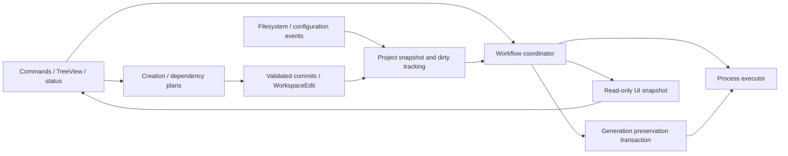

# Proposed architecture

Retain CommonJS, native VS Code UI, pure template/parser functions and the existing tests. No framework, dependency-injection container, event bus, database or language-server rewrite is justified by this extension's complexity. Folder moves are a later readability improvement, not a prerequisite for defect fixes.

## Ownership model

1. **Composition and VS Code adapters:** activation constructs each service once, wires explicit callbacks and registers one disposable per service. Command adapters translate UI input/errors; UI observes snapshots rather than mutating domain state.
2. **Project/engine model:** one validated ProjectContext includes root/descriptor identity, modules, targets and engine capabilities. Configuration adapters normalize settings and protect writes. Discovery should return structured limitations rather than silently asserting full UBT knowledge.
3. **Workflow coordinator:** retain one build/regeneration operation gate, revision-based coverage and bounded history. Define states and results (`Preparing`, `Regenerating`, `Building`, succeeded/failed/cancelled/blocked). Add an explicit cancellation handshake and project epoch.
4. **Execution and preservation:** process executor owns child lifecycle/stream parsing; generation transaction owns snapshots, conflict detection and recovery. Only these adapters perform their relevant I/O. Shared engine configuration needs conflict protection across windows even if global operation locking remains out of scope.
5. **Creation and dependency plans:** pure plans remain separate from commits. File-write and WorkspaceEdit paths keep their different persistence/Undo semantics. Share validation helpers where semantics match, not a generic transaction framework covering every operation.



## Incremental folder proposal

```text
unreal-auto-setup/
  extension.js                  # small composition/registration entry point
  vscode/
    commands.js                 # command registration and user-facing errors
    configuration.js            # setting normalization and protected updates
    sidebar.js                  # native view projection
    status.js                   # Build / Run items
    dependencyUI.js             # diff, Quick Fix and preview provider
  unreal/
    project.js                  # descriptor/target context
    engine.js                   # installation discovery and capabilities
    modules.js                  # local modules/plugins
    targets.js                  # conservative target parser
    templates/                  # class/module pure rendering
    dependencies/               # restricted Build.cs parser, model, ownership index
  workflows/
    setup.js                    # identity-checked setup
    build.js                    # build/run orchestration
    generation.js               # preserve, execute, restore-or-report-conflict
    creation.js                 # creation plan/commit orchestration
  runtime/
    coordinator.js              # gate/debounce/results/cancellation
    projectSession.js           # metadata and operation state
    dirtyTracker.js             # source classification/revision coverage
    watcher.js                  # scoped event collection/reconciliation
  platform/
    windowsProcesses.js         # PowerShell/CIM, owned process termination
    processExecutor.js          # stream lifetime and completion
    safeFiles.js                # shared containment/ancestor/conflict primitives
  tests/                        # retain and grow existing suites
  media/
  package.json
```

These are proposed ownership destinations, not instructions to create every file now. Keep small modules together until a real change needs the split. Preserve `local-tools.unreal-project-tools`, all public commands/settings, and exported compatibility helpers during migration. Update packaging lists/tests atomically when paths eventually move.

## Changes by necessity

| Category | Recommendation | Reason |
| --- | --- | --- |
| Required fixes | Conflict-safe generation preservation; termination acknowledgement; bounded operation resource ownership; consistent engine requirements; literal-aware targets | F01–F05 are actual source/probe findings |
| Maintainability | Format dense functions; JSDoc service/result/context contracts; narrow runner/UI responsibilities; unify policy-bearing validation; contain async errors | Q01–Q07 make behavior easier to reason about without changing features |
| Optional architecture | Proposed directories, partial TypeScript migration, external process executor interface for future platforms, cross-window operation coordination | Useful only if growth/workload warrants; no immediate rewrite needed |
| New features | Broader source extension support, additional platforms/multi-root, richer include visibility diagnostics, additional target/host support | Separate product decisions and compatibility tests; not prerequisites for this audit's fixes |

## Contracts worth making explicit

Project identity should include descriptor path and a workspace epoch. Recheck it after user input and before settings/file/process mutations. Cancellation should report request accepted, termination confirmed or termination failed; the coordinator must not confuse a requested stop with a stopped process.

A generation result should carry execution outcome, preservation outcome, conflicts and recoverable paths. A successful UBT exit with a failed restore is not complete success. Never discard the newer user version merely to satisfy a stale flag.

Configuration should distinguish **requested capability**, **detected files**, **version-policy acceptance**, and **tested compatibility**. Avoid the current ambiguous `compatible` being read as proof of all workflows. JSDoc discriminated objects can express these contracts without installing tooling; optional `checkJs` can follow later.

Use typed/structured errors only where recovery differs (user cancelled, project changed, conflict, tool failed). Ordinary helper exceptions can remain Error. Centralize final user messaging at workflow/command boundaries and catch every fire-and-forget event promise. Keep meaningful logs and bounded UI history.

Performance improvements should follow measurement: reuse discovered project data per refresh, limit events by affected path and cancel obsolete scans. Do not introduce persistent engine caches until invalidation semantics and actual scan costs are known.
