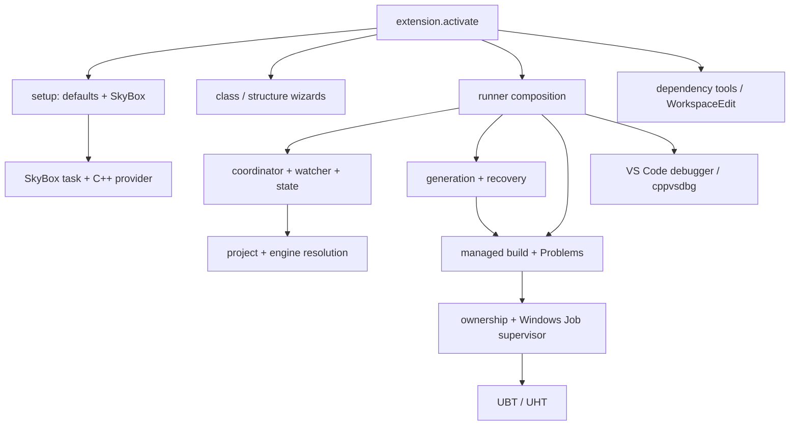

# Ownership matrix

Evidence: current 1.0.0 Alpha source. Dispositions are recommendations, not implemented changes. “Replace” applies to the stated responsibility, not blanket deletion of all listed files.

| Concern / current files | Authoritative owner | Disposition | Present behavior, duplication and boundary |
|---|---|---|---|
| Activation and setup: [extension.js:1](../../../../unreal-auto-setup/extension.js), [core.js:1](../../../../unreal-auto-setup/core.js) | Extension / VS Code | Replace | Single-root auto-setup installs SkyBox, merges settings, creates provider config/task, and stores configured marker. Replace with explicit minimal bootstrap; remove mandatory companion activation and opinionated formatting defaults after replacement proof. |
| Project and engine discovery: [project.js:1](../../../../unreal-auto-setup/project.js), [engine.js:1](../../../../unreal-auto-setup/engine.js), [enginePolicy.js:1](../../../../unreal-auto-setup/enginePolicy.js), [paths.js:1](../../../../unreal-auto-setup/paths.js) | Extension / Unreal descriptor | Replace | Retain descriptor/version checks and bounded engine discovery; replace single-root selection and companion-owned settings dependence with explicit project/engine/workspace identity. |
| Creation: [classWizard.js:1](../../../../unreal-auto-setup/classWizard.js), [explorerClass.js:1](../../../../unreal-auto-setup/explorerClass.js), [classTemplates.js:1](../../../../unreal-auto-setup/classTemplates.js), [classFiles.js:1](../../../../unreal-auto-setup/classFiles.js), [structureWizard.js:1](../../../../unreal-auto-setup/structureWizard.js), [creation.js:1](../../../../unreal-auto-setup/creation.js), [moduleTemplates.js:1](../../../../unreal-auto-setup/moduleTemplates.js), [descriptors.js:1](../../../../unreal-auto-setup/descriptors.js), [modules.js:1](../../../../unreal-auto-setup/modules.js) | Extension / user source | Keep | Retain templates, module discovery, exclusive creation and validation. Replace folder-count guards and silent UI lock behavior. Descriptor replacement uses check-then-rename, not atomic compare-and-swap; review concurrency separately. |
| Build workflow: [runner.js:1](../../../../unreal-auto-setup/runner.js), [runtimeCommands.js:1](../../../../unreal-auto-setup/runtimeCommands.js), [runtimeCoordinator.js:1](../../../../unreal-auto-setup/runtimeCoordinator.js), [dirtyTracker.js:1](../../../../unreal-auto-setup/dirtyTracker.js), [runtime.js:1](../../../../unreal-auto-setup/runtime.js) | Extension orchestration / UBT | Replace | Keep admission and state semantics; simplify duplicated selections and stale=>generate coupling. Distinguish build, metadata and IntelliSense readiness. Watch/off stays conservative. |
| Execution and Problems: [build.js:1](../../../../unreal-auto-setup/build.js), [problemParser.js:1](../../../../unreal-auto-setup/problemParser.js) | UBT / VS Code / extension | Delegate | UBT already owns compilation. Evaluate native tasks and problem matchers; retain managed parser/execution until real equivalence is shown. Shell task and managed build currently bypass each other’s admission. |
| Process safety: [processSupervisor.js:1](../../../../unreal-auto-setup/processSupervisor.js), [operationOwnership.js:1](../../../../unreal-auto-setup/operationOwnership.js), [processes.js:1](../../../../unreal-auto-setup/processes.js), [liveCoding.js:1](../../../../unreal-auto-setup/liveCoding.js) | Extension safety / Windows / Unreal Editor | Keep | Keep verified Job Object completion, immutable claims, process identity and running-Editor block. Native task cancellation equivalence is unproven. Live Coding is awareness only. |
| Regeneration: [generation.js:1](../../../../unreal-auto-setup/generation.js), [generationGuard.js:1](../../../../unreal-auto-setup/generationGuard.js), [generationRecovery.js:1](../../../../unreal-auto-setup/generationRecovery.js) | UBT writer / extension recovery | Investigate | P1.1 open. Recovery detects conflicts and keeps copies but cannot stop UBT writes. Replace conflicting workflow only after ownership proof; keep no-restore policy and failing assertion. |
| Debugger: [debugger.js:1](../../../../unreal-auto-setup/debugger.js) | VS Code / Microsoft C++ | Delegate | Already uses startDebugging/stopDebugging with cppvsdbg. Retain project PID validation and detach scope. Reuse generated configurations only after validity checks; do not build another adapter. |
| Dependency tools: [buildCsParser.js:1](../../../../unreal-auto-setup/buildCsParser.js), [dependencyModel.js:1](../../../../unreal-auto-setup/dependencyModel.js), [dependencyEditor.js:1](../../../../unreal-auto-setup/dependencyEditor.js), [dependencyIndex.js:1](../../../../unreal-auto-setup/dependencyIndex.js), [dependencyActions.js:1](../../../../unreal-auto-setup/dependencyActions.js), [dependencyDiagnostics.js:1](../../../../unreal-auto-setup/dependencyDiagnostics.js) | Extension advice / UBT rules / VS Code edits | Keep | Retain bounded lexical parsing, explicit index refresh, diagnostics and WorkspaceEdit/Undo. UBT remains authority for arbitrary C# rules. Simplify root scoping; never edit engine modules. |
| Runtime UX: [runtimeWatcher.js:1](../../../../unreal-auto-setup/runtimeWatcher.js), [runtimeView.js:1](../../../../unreal-auto-setup/runtimeView.js), [sidebar.js:1](../../../../unreal-auto-setup/sidebar.js), [diagnostics.js:1](../../../../unreal-auto-setup/diagnostics.js), [contracts.js:1](../../../../unreal-auto-setup/contracts.js) | Extension / VS Code | Replace | Keep useful Doctor/status, simplify replicated state and first-root watching. Doctor currently checks config existence, not per-translation-unit compile coverage. No rewrite of stable presentation is needed merely for appearance. |

All 41 runtime JS modules are accounted for above. Native `native/OperationSupervisor.cs` and packaged helper remain Keep; source/binary hashes are checked by processSupervisor.verifyHelper. Four snippets are Keep as VS Code-native contributions. Test tooling is Keep with scope corrections: tools/run-tests.cjs isolates temporary outputs; tools/run-extension-tests.cjs uses scratch profiles; real-unreal-validation.js needs owned fixture roots; validate-release.cjs must continue treating every test failure as failure. Python bundling and the Windows workflow remain Keep, with release version naming flagged for later maintenance.

## Public command inventory (35/35)

All IDs retain the `unrealSetup.` prefix. No IDs were renamed or removed.

| Command ID | Current adapter / owner | Proposed disposition and reason |
|---|---|---|
| `unrealSetup.setup` | [extension.js:1](../../../../unreal-auto-setup/extension.js); extension adapter over native APIs | **Replace**: Minimal two-root bootstrap; preserve public alias |
| `unrealSetup.build` | [runtimeCommands.js:1](../../../../unreal-auto-setup/runtimeCommands.js); extension adapter over native APIs | **Investigate**: Keep UX, delegate build to UBT/native task surface; remove implicit regeneration only after ownership proof |
| `unrealSetup.buildAndRun` | [runtimeCommands.js:1](../../../../unreal-auto-setup/runtimeCommands.js); extension adapter over native APIs | **Investigate**: Keep UX, delegate build to UBT/native task surface; remove implicit regeneration only after ownership proof |
| `unrealSetup.installExtensions` | [extension.js:1](../../../../unreal-auto-setup/extension.js); extension adapter over native APIs | **Replace**: Optional explicit companion selection; remove automatic installation coupling |
| `unrealSetup.openEditor` | [runtimeCommands.js:1](../../../../unreal-auto-setup/runtimeCommands.js); extension adapter over native APIs | **Investigate**: Keep UX, delegate build to UBT/native task surface; remove implicit regeneration only after ownership proof |
| `unrealSetup.selectTarget` | [runtimeCommands.js:1](../../../../unreal-auto-setup/runtimeCommands.js); extension adapter over native APIs | **Keep**: Simplify one authoritative selection; UBT validates target rules |
| `unrealSetup.selectPlatform` | [runtimeCommands.js:1](../../../../unreal-auto-setup/runtimeCommands.js); extension adapter over native APIs | **Keep**: Simplify one authoritative selection; UBT validates target rules |
| `unrealSetup.selectConfiguration` | [runtimeCommands.js:1](../../../../unreal-auto-setup/runtimeCommands.js); extension adapter over native APIs | **Keep**: Simplify one authoritative selection; UBT validates target rules |
| `unrealSetup.selectBuild` | [runtimeCommands.js:1](../../../../unreal-auto-setup/runtimeCommands.js); extension adapter over native APIs | **Keep**: Simplify one authoritative selection; UBT validates target rules |
| `unrealSetup.diagnose` | [diagnostics.js:1](../../../../unreal-auto-setup/diagnostics.js); extension adapter over native APIs | **Keep**: Expand metadata/provider evidence; preserve read-only navigation |
| `unrealSetup.openLatestLog` | [diagnostics.js:1](../../../../unreal-auto-setup/diagnostics.js); extension adapter over native APIs | **Keep**: Expand metadata/provider evidence; preserve read-only navigation |
| `unrealSetup.attachDebugger` | [debugger.js:1](../../../../unreal-auto-setup/debugger.js); extension adapter over native APIs | **Delegate**: Native debug API and cpptools; keep PID safety |
| `unrealSetup.regenerate` | [runtimeCommands.js:1](../../../../unreal-auto-setup/runtimeCommands.js); extension adapter over native APIs | **Investigate**: Keep UX, delegate build to UBT/native task surface; remove implicit regeneration only after ownership proof |
| `unrealSetup.newClass` | [classWizard.js:1](../../../../unreal-auto-setup/classWizard.js); extension adapter over native APIs | **Keep**: Fix lock lifecycle later; use URI owner instead of root count |
| `unrealSetup.openModuleRules` | [classWizard.js:1](../../../../unreal-auto-setup/classWizard.js); extension adapter over native APIs | **Keep**: Fix lock lifecycle later; use URI owner instead of root count |
| `unrealSetup.openProjectDescriptor` | [classWizard.js:1](../../../../unreal-auto-setup/classWizard.js); extension adapter over native APIs | **Keep**: Fix lock lifecycle later; use URI owner instead of root count |
| `unrealSetup.openTargetRules` | [classWizard.js:1](../../../../unreal-auto-setup/classWizard.js); extension adapter over native APIs | **Keep**: Fix lock lifecycle later; use URI owner instead of root count |
| `unrealSetup.newModule` | [structureWizard.js:1](../../../../unreal-auto-setup/structureWizard.js); extension adapter over native APIs | **Keep**: Preserve file safety; investigate analogous notification lock |
| `unrealSetup.newPlugin` | [structureWizard.js:1](../../../../unreal-auto-setup/structureWizard.js); extension adapter over native APIs | **Keep**: Preserve file safety; investigate analogous notification lock |
| `unrealSetup.openPluginDescriptor` | [structureWizard.js:1](../../../../unreal-auto-setup/structureWizard.js); extension adapter over native APIs | **Keep**: Preserve file safety; investigate analogous notification lock |
| `unrealSetup.run` | [runtimeCommands.js:1](../../../../unreal-auto-setup/runtimeCommands.js); extension adapter over native APIs | **Investigate**: Keep UX, delegate build to UBT/native task surface; remove implicit regeneration only after ownership proof |
| `unrealSetup.refresh` | [runner.js:1](../../../../unreal-auto-setup/runner.js); extension adapter over native APIs | **Keep**: Reconcile correct project without automatic generation |
| `unrealSetup.createClassHere` | [classWizard.js:1](../../../../unreal-auto-setup/classWizard.js); extension adapter over native APIs | **Keep**: Fix lock lifecycle later; use URI owner instead of root count |
| `unrealSetup.inspectDependencies` | [dependencyActions.js:1](../../../../unreal-auto-setup/dependencyActions.js); extension adapter over native APIs | **Keep**: Preserve advice/WorkspaceEdit and explicit engine indexing |
| `unrealSetup.addDependency` | [dependencyActions.js:1](../../../../unreal-auto-setup/dependencyActions.js); extension adapter over native APIs | **Keep**: Preserve advice/WorkspaceEdit and explicit engine indexing |
| `unrealSetup.removeDependency` | [dependencyActions.js:1](../../../../unreal-auto-setup/dependencyActions.js); extension adapter over native APIs | **Keep**: Preserve advice/WorkspaceEdit and explicit engine indexing |
| `unrealSetup.changeDependencyVisibility` | [dependencyActions.js:1](../../../../unreal-auto-setup/dependencyActions.js); extension adapter over native APIs | **Keep**: Preserve advice/WorkspaceEdit and explicit engine indexing |
| `unrealSetup.findModuleForInclude` | [dependencyActions.js:1](../../../../unreal-auto-setup/dependencyActions.js); extension adapter over native APIs | **Keep**: Preserve advice/WorkspaceEdit and explicit engine indexing |
| `unrealSetup.refreshDependencyIndex` | [dependencyActions.js:1](../../../../unreal-auto-setup/dependencyActions.js); extension adapter over native APIs | **Keep**: Preserve advice/WorkspaceEdit and explicit engine indexing |
| `unrealSetup.manageDependencies` | [dependencyActions.js:1](../../../../unreal-auto-setup/dependencyActions.js); extension adapter over native APIs | **Keep**: Preserve advice/WorkspaceEdit and explicit engine indexing |
| `unrealSetup.automationMode` | [runtimeCommands.js:1](../../../../unreal-auto-setup/runtimeCommands.js); extension adapter over native APIs | **Keep**: Scope to selected project; preserve safe cancellation; reconsider auto-regenerate mode |
| `unrealSetup.autoBuildDelay` | [runtimeCommands.js:1](../../../../unreal-auto-setup/runtimeCommands.js); extension adapter over native APIs | **Keep**: Scope to selected project; preserve safe cancellation; reconsider auto-regenerate mode |
| `unrealSetup.runtimeInterval` | [runtimeCommands.js:1](../../../../unreal-auto-setup/runtimeCommands.js); extension adapter over native APIs | **Keep**: Scope to selected project; preserve safe cancellation; reconsider auto-regenerate mode |
| `unrealSetup.cancelPendingAutomaticBuild` | [runtimeCommands.js:1](../../../../unreal-auto-setup/runtimeCommands.js); extension adapter over native APIs | **Keep**: Scope to selected project; preserve safe cancellation; reconsider auto-regenerate mode |
| `unrealSetup.cancelBuild` | [runtimeCommands.js:1](../../../../unreal-auto-setup/runtimeCommands.js); extension adapter over native APIs | **Keep**: Scope to selected project; preserve safe cancellation; reconsider auto-regenerate mode |

## Configuration and activation

| Setting | Current default / scope | Future treatment |
|---|---|---|
| `unrealSetup.autoSetup` | `true` / window | Keep compatibility; resolve against explicit project; review bootstrap/automation policy |
| `unrealSetup.runtimeRefreshInterval` | `30` / omitted in manifest | Keep compatibility; resolve against explicit project; review bootstrap/automation policy |
| `unrealSetup.automationMode` | `"watch"` / resource | Keep compatibility; resolve against explicit project; review bootstrap/automation policy |
| `unrealSetup.autoBuildDelay` | `30` / resource | Keep compatibility; resolve against explicit project; review bootstrap/automation policy |
| `unrealSetup.verboseRuntimeLogging` | `false` / resource | Keep compatibility; resolve against explicit project; review bootstrap/automation policy |

Activation is `onStartupFinished`, extensionKind workspace, untrustedWorkspaces false and virtualWorkspaces false. extensionPack includes cpptools and SkyBox; extensionDependencies is absent. Setup additionally invokes installation and activates SkyBox. `unrealEngine.enginePath` and `unrealEngine.defaultProject` are consumed/written but contributed by SkyBox, not ours. Core settings also write associations, exclusions and C++ formatting defaults; these are integration policy, not Unreal build requirements. Explorer menus depend on `unrealSetup.projectActive`, trust and enumerated classFolders/moduleRules context; first-root discovery failures can therefore hide commands as well as reject execution.

## Conditional deletion candidates

Remove mandatory companion installation/activation, generated custom-task JSON duplication, opinionated formatting defaults, and redundant “configured” state only once native/bootstrap replacements are proven. Simplify compatibility build-script helpers if caller inventory proves they are unused. Do not delete process supervision, conflict evidence, class templates or dependency tools merely to reduce file count. No deletion is authorized in Phase 1A.
